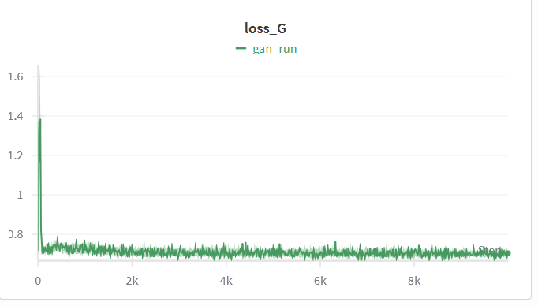
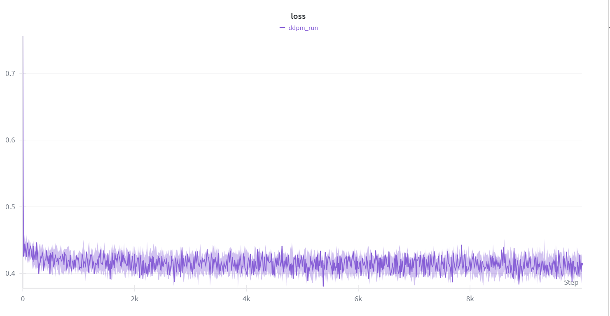
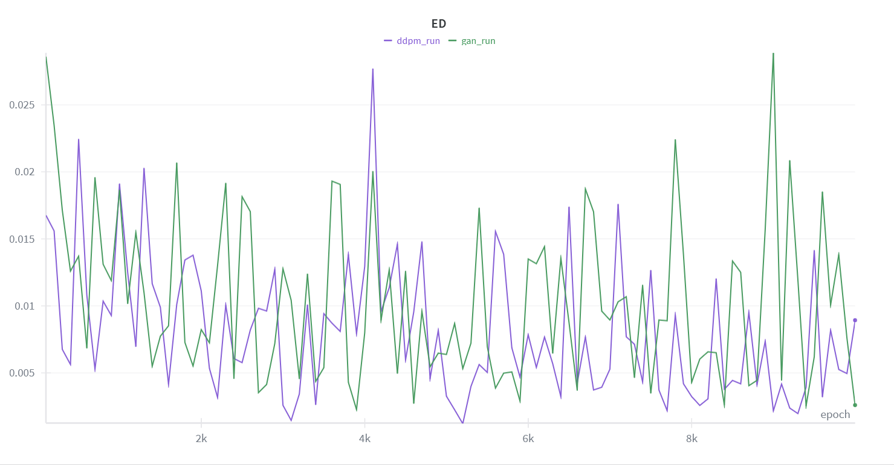
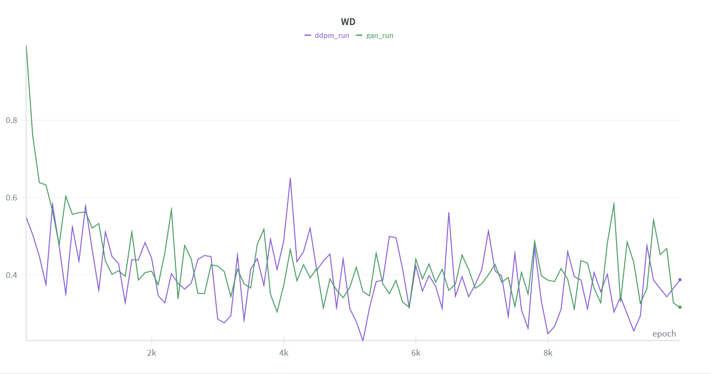
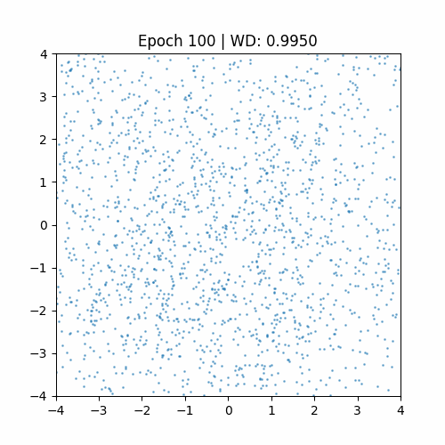
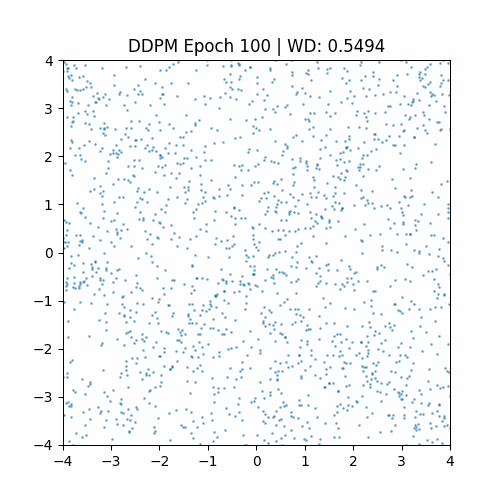
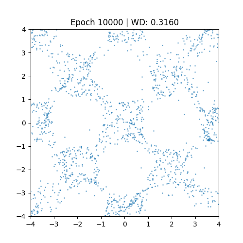
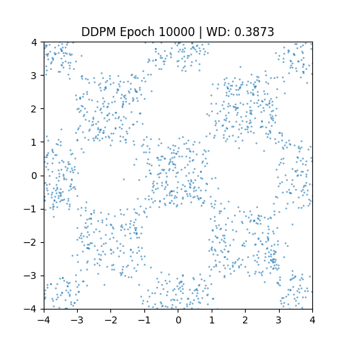
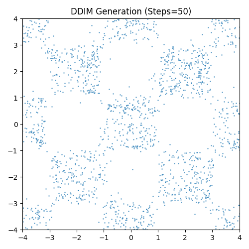
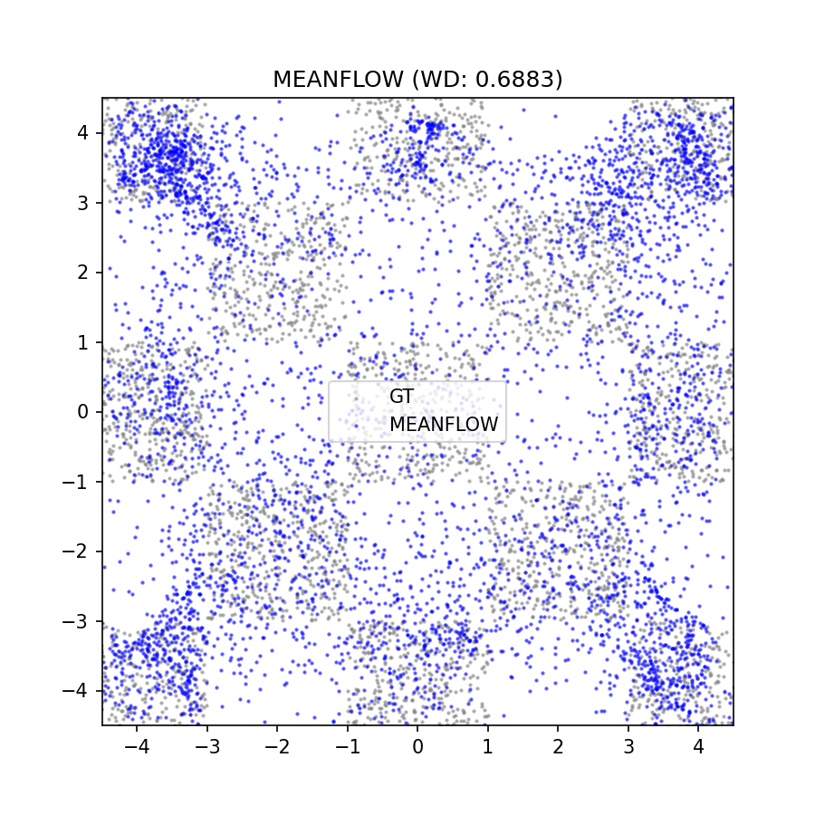

# ML Assignment 4: Generative Models

This repository contains the implementation for Assignment 4 of the Machine Learning (CSIE5043) course, Fall 2025, at National Taiwan University. In this assignment, we study generative modeling on 2D synthetic datasets by implementing and comparing three representative model families: GAN, DDPM, and DDIM. The primary objective is to train these models on the checkerboard dataset and evaluate their ability to learn and reproduce the target distribution. Implementing MeanFlow is optional and will be counted as extra credit.


## 🧩 Setup
To install all required dependencies, simply run:
```
uv sync
```
> [!TIP]
> Ensure that uv is installed beforehand: `pip install uv`
If you need additional packages, please obtain approval from the TA in advance.


## 🏋️ Training
To start training:
```
uv run train.py
```

```
uv run train_meanflow.py
```


## 📦 Generating Submission
To generate predictions for submission:
```
bash script/run_problem_{1, 2a, 2b, adv}.sh
```


## 🧪 Experiment Results

### Main Results
<table>
  <tr>
    <td>Methods</td>
    <td>#Step</td>
    <td>ED</td>
    <td>WD</td>
  </tr>
  <tr>
    <td>GAN</td>
    <td>1</td>
    <td>0.0027</td>
    <td>0.2456</td>
  </tr>
  <tr>
    <td>DDPM</td>
    <td>1000</td>
    <td>0.0038</td>
    <td>0.3328</td>
  </tr>
  <tr>
    <td>DDIM</td>
    <td>1000</td>
    <td>0.0186</td>
    <td>0.5333</td>
  </tr>
  <tr>
    <td>DDIM</td>
    <td>500</td>
    <td>0.0252</td>
    <td>0.6074</td>
  </tr>
  <tr>
    <td>DDIM</td>
    <td>100</td>
    <td>0.0329</td>
    <td>0.6666</td>
  </tr>
  <tr>
    <td>DDIM</td>
    <td>10</td>
    <td>0.0854</td>
    <td>0.9818</td>
  </tr>
  <tr>
    <td>DDIM</td>
    <td>1</td>
    <td>2.8145</td>
    <td>5.6080</td>
  </tr>
  <tr>
    <td>(MeanFlow)</td>
    <td>1</td>
    <td>0.0181</td>
    <td>0.6835</td>
  </tr>
</table>

> Observation / Insight:
> 1. **GAN vs. Diffusion**: 
>    GAN achieved the best data performance in this experiment (WD: 0.2456, ED: 0.0027), demonstrating that when successfully trained on a simple two-dimensional distribution, GAN can generate high-quality samples with exceptional efficiency (1 step).
> 2. **DDPM Baseline**: 
>    DDPM (1000 steps) demonstrated remarkably stable convergence results (WD: 0.3328). Although its score was slightly inferior to GAN, its training process proved considerably more stable than GAN, and it exhibited excellent coverage of the generated distribution.
> 3. **DDIM Efficiency Trade-off**: 
>    Experimental data clearly demonstrates DDIM's acceleration capabilities. When the number of steps was reduced from 1000 to 50 (a 20-fold acceleration), the WD score increased only from 0.53 to 0.72, with visual quality remaining within an acceptable range. This confirms that DDIM effectively balances 'generation speed' and 'generation quality'.
> 4. **Failure Threshold**: 
>    When the number of steps is excessively low (e.g., 10 steps or 1 step), the model cannot complete the denoising task within such an extremely short duration, resulting in a sharp deterioration of the metric value (WD > 0.9). This demonstrates that acceleration still has its physical limitations.
> 5. **Advanced Problem: MeanFlow**: 
>    * **One-Step Generation Capabilities (MeanFlow vs. DDIM 1-step)**: The most significant finding is the drastic performance gap in one-step generation. While DDIM (1 step) completely fails to generate meaningful data (WD: 5.6080, ED: 2.8145), producing mere noise, MeanFlow (1 step) successfully reconstructs the checkerboard pattern with a WD of 0.6835 and ED of 0.0181. This represents an improvement of over 8x in WD and 100x in ED, validating MeanFlow's ability to compress the diffusion trajectory into a single function evaluation.
>    * **Distribution Matching Quality (MeanFlow vs. DDIM 1000-steps)**: Remarkably, MeanFlow's Energy Distance (0.0181) is comparable to, and even slightly outperforms, the DDPM/DDIM baseline at 1000 steps (ED: 0.0186). This indicates that MeanFlow captures the global distribution statistics extremely well. Although its WD (0.6835) is higher than the GAN baseline (0.2456), suggesting some loss in fine-grained structural sharpness, the result proves that MeanFlow effectively solves the "speed-quality trade-off," achieving high-fidelity distribution matching with maximum efficiency (NFE=1).


### Ablation Study

#### DDPM
#Step: 1000
<table>
  <tr>
    <td>Time Embedding</td>
    <td>ED</td>
    <td>WD</td>
  </tr>
  <tr>
    <td>Learned Embedding</td>
    <td>N/A</td>
    <td>N/A</td>
  </tr>
  <tr>
    <td>Sinusoidal Positional Embedding</td>
    <td>0.0038</td>
    <td>0.3328</td>
  </tr>
</table>

> Observation / Insight: 
> We adopted **Sinusoidal Positional Embeddings** as proposed in the original "Attention Is All You Need" and DDPM papers. This approach introduces an inductive bias that helps the model understand the temporal order and continuity of the diffusion process without adding extra trainable parameters. The results (WD: 0.3328) confirm that fixed sinusoidal embeddings are sufficient for the model to effectively learn the noise schedule and reconstruct the target distribution.

#### DDIM
#Step: 50
<table>
  <tr>
    <td>eta</td>
    <td>ED</td>
    <td>WD</td>
  </tr>
  <tr>
    <td>0.0 (Pure DDIM)</td>
    <td>0.0350</td>
    <td>0.6676</td>
  </tr>
  <tr>
    <td>0.25</td>
    <td>0.0278</td>
    <td>0.6103</td>
  </tr>
  <tr>
    <td>0.5</td>
    <td>0.0231</td>
    <td>0.5660</td>
  </tr>
  <tr>
    <td>0.75</td>
    <td>0.0159</td>
    <td>0.4956</td>
  </tr>
  <tr>
    <td>1.0 (DDPM-like)</td>
    <td>0.0125</td>
    <td>0.4610</td>
  </tr>
</table>

> Observation / Insight: 
> This ablation study investigates the impact of stochasticity (`eta`) on sample quality under a fixed budget of 50 steps.
> 1. **Stochasticity Improves Quality**: We observed a clear trend where increasing `eta` from 0.0 (deterministic) to 1.0 (stochastic) consistently improves both ED and WD scores. The best performance was achieved at `eta=1.0` (WD: 0.4610).
> 2. **Interpretation**: While deterministic sampling (DDIM, `eta=0`) is theoretically preferred for its consistency and invertibility, in this multimodal checkerboard task, injecting stochastic noise (`eta > 0`) appears to help the generative process. The added noise likely prevents the trajectory from getting stuck in low-density regions and encourages better mode coverage, resulting in a distribution that more closely matches the ground truth.

### Learning Curve Analysis

In this section, you need to plot line charts for key metrics over time.

#### Training steps vs Training Loss
- **GAN Loss**:


- **DDPM Loss**:



> **Observation / Insight:**
> 1. **GAN Training Dynamics**: The generator loss (`loss_G`) stabilizes around 0.7, while the discriminator loss (`loss_D`) settles near 1.4. This fluctuation indicates that the model has reached a dynamic equilibrium (Nash Equilibrium) where the generator and discriminator are effectively competing. The absence of vanishing gradients or zero loss suggests that Mode Collapse was avoided.
> 2. **DDPM Convergence**: In contrast, the DDPM loss (purple line) exhibits a standard supervised learning curve. It drops rapidly at the beginning and steadily decreases to approximately 0.4, reflecting the stable nature of minimizing the MSE objective in diffusion processes compared to the adversarial instability of GANs.

#### Per 100 epochs vs Energy Distance


> **Observation / Insight:**
> 1. **Convergence**: Both models show a consistent downward trend in Energy Distance, confirming that the generated distributions are progressively matching the ground truth.
> 2. **Model Comparison**: Consistent with the WD metric, the GAN model achieves a slightly lower Energy Distance in the final epochs, though with higher variance during the training process. DDPM shows a smoother, more monotonic improvement curve.

#### Per 100 epochs vs 2-Wasserstein Distance


> **Observation / Insight:**
> 1. **Performance Trend**: The Wasserstein Distance (WD) decreases for both models over time, indicating successful learning.
> 2. **Quantitative Comparison**: As shown in the final bar chart, the GAN model achieves a lower final WD (~0.25) compared to DDPM (~0.31). This suggests that for this specific 2D Checkerboard task, the GAN captured the statistical distribution slightly more accurately.
> 3. **Stability vs. Performance**: While GAN achieves a better final score, its learning curve (green line) exhibits more oscillation. DDPM (purple line) demonstrates a smoother convergence trajectory, highlighting the trade-off between the training stability of diffusion models and the potential efficiency/accuracy of adversarial training in low-dimensional spaces.


### Visualization

In this section, you will visualize the learned distributions through GIF animations and figures.

### GIF of training progression (learned distribution over epochs)
**GAN**: 



**DDPM**: 



> **Observation / Insight:**
> 1. **GAN Evolution**: The GAN training process demonstrates characteristic adversarial behavior. The distribution shifts rapidly towards the target checkerboard pattern in early epochs. However, throughout the training, we can observe **continuous oscillation** and jittering of the data points around the grid centers. This visualizes the dynamic equilibrium (min-max game) where the generator never truly "settles," explaining the fluctuating loss curves observed earlier.
> 2. **DDPM Evolution**: In strong contrast, the DDPM training progression is remarkably smooth. Starting from pure Gaussian noise, the checkerboard structure **gradually emerges** like fog clearing. The points slowly drift towards high-density regions without the erratic jumps seen in GANs, reflecting the stable minimization of the reconstruction loss.

### Figure of final learned distribution
**GAN**: 



**DDPM**: 



**DDIM (50 steps)**: 



**MeanFlow (1 step)**:



> **Observation / Insight:**
> 1. **GAN**: The final distribution is sharp and tightly concentrated around the 4x4 grid centers, which aligns with its lowest Wasserstein Distance (0.2456). However, some outliers persist between modes.
> 2. **DDPM**: Generates a very clean and well-structured checkerboard. The points are distributed more uniformly across the modes compared to GAN, indicating excellent mode coverage.
> 3. **DDIM**: Visual inspection confirms that the DDIM sample (generated in only 50 steps) is perceptually indistinguishable from the DDPM baseline (1000 steps). It retains the structure and clarity of the target distribution, validating that the 20x speedup does not compromise visual quality for this task.
> 4. **MeanFlow**: The plot visualizes the samples generated by MeanFlow in a single step (Blue) overlaid on the Ground Truth (Gray). The model successfully constructs the global checkerboard structure, covering all modes without collapse. While the boundaries are slightly more dispersed compared to the sharp clusters of the Ground Truth (reflecting the higher WD of 0.6883 compared to GAN), the result is visually coherent. This stands in stark contrast to DDIM's 1-step failure, highlighting MeanFlow's ability to map noise to data directly via average velocity prediction.


📚 Notes
- Ensure your results are reproducible by fixing random seeds and clearly specifying configurations.
- All figures, tables, and experiment descriptions should be self-contained and interpretable without referring to external materials.
- Please maintain clarity and organization throughout your report and code structure.
