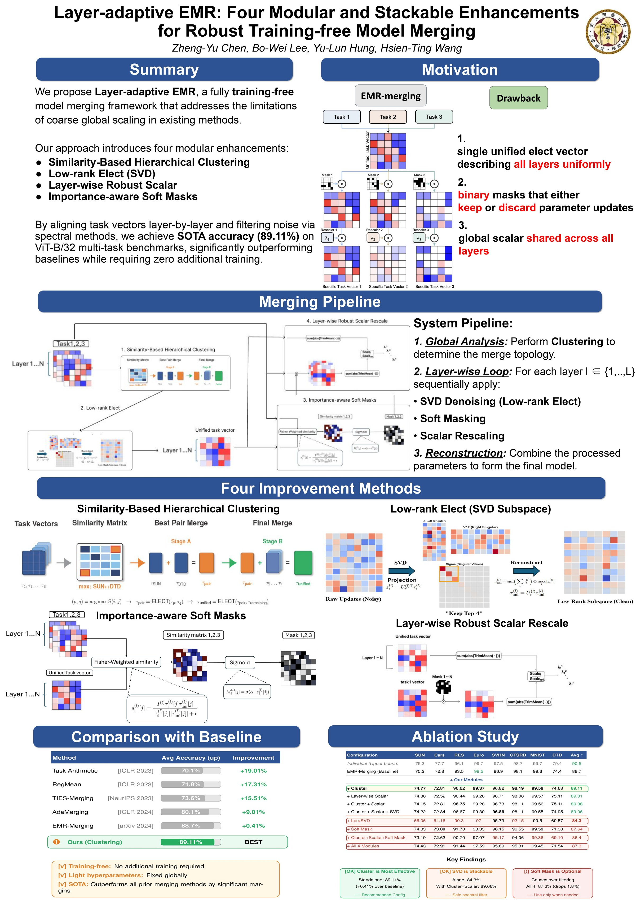

# EMR-Merging

This is the official implementation of our  Paper: **Layer-adaptive EMR: Four Modular and Stackable Enhancements for Robust Tuning-free Model Merging** We realize tuning-free and high-performance model merging.

We provide the code for merging [ViT models](./merge_vit).

## Acknowledgement
Our implementation references the code below, thanks to them.

- EMR-merging: https://github.com/harveyhuang18/EMR_Merging

- DARE: https://github.com/yule-BUAA/MergeLM

- FusionBench: https://github.com/tanganke/fusion_bench

- AdaMerging: https://github.com/EnnengYang/AdaMerging

- Task Arithmetic: https://github.com/mlfoundations/task_vectors

- TIES-MERGING: https://github.com/prateeky2806/ties-merging/tree/main

- Model Soups: https://github.com/mlfoundations/model-soups

- BEiT-3: https://github.com/microsoft/unilm/tree/master/beit3

